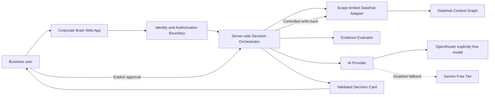
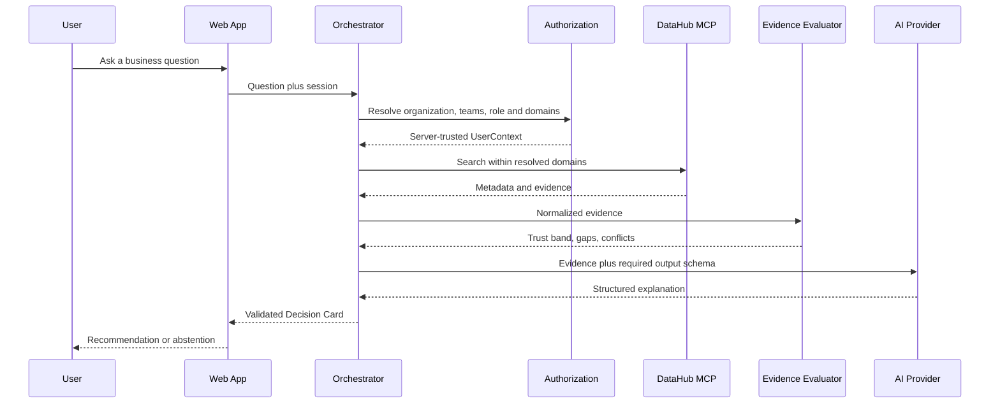
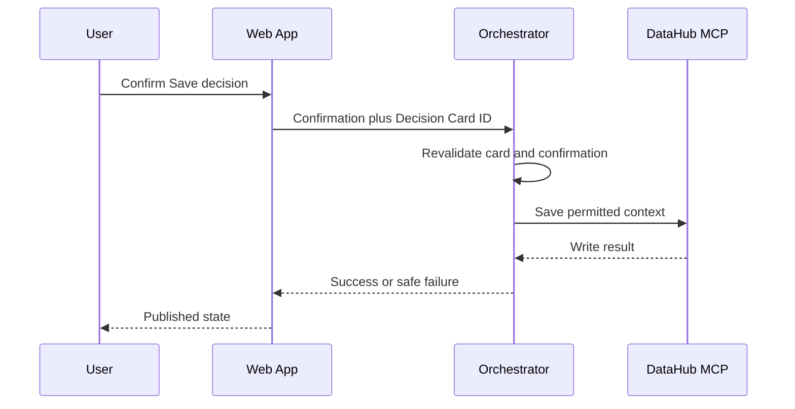

# Corporate Brain — Architecture

## 1. Architecture objective

The MVP must be simple to operate, trustworthy, replaceable by component, and deployable without paid infrastructure.

The system separates evidence retrieval, deterministic assessment, AI synthesis, and consequential writes. The LLM is not the source of truth.

## 2. System context



## 3. Components

### Web application

Responsibilities:

- Render the Ask, Decision Brief, and Corporate Memory experiences
- Collect explicit human confirmation
- Display loading, unavailable, conflicting, and insufficient-evidence states
- Never access provider or DataHub secrets

Planned technology:

- Next.js App Router
- TypeScript
- Server Components by default
- Client Components only for interactions that require browser state

### Decision orchestrator

Responsibilities:

- Receive and validate a business question
- Require a server-resolved user context
- Select the allowed DataHub retrieval workflow
- Normalize DataHub evidence
- Run deterministic evidence rules
- Call the configured AI provider
- Validate the Decision Card
- Require confirmation before write-back

The orchestrator must not allow the model to select arbitrary network endpoints or execute arbitrary code.

### Identity and authorization boundary

The authorization boundary runs before evidence retrieval and before every consequential write.

Resolved user context:

```ts
interface UserContext {
  organizationId: string;
  userId: string;
  teamIds: string[];
  role: "executive" | "manager" | "analyst" | "data-steward";
  allowedDomains: string[];
  locale: "en" | "es";
  detailPreference: "summary" | "operational" | "technical";
}
```

Rules:

- Default deny: an unlisted domain is inaccessible.
- The browser cannot grant itself a team or domain.
- Authorization is deterministic server logic, never an LLM decision.
- Retrieval queries must carry an already resolved scope.
- Hidden entities are not named, counted, cached across users, or sent to the AI provider.
- If the remaining authorized evidence is insufficient, the evaluator abstains.

The hackathon UI uses an explicit synthetic persona switcher to demonstrate these rules. It is not presented as production authentication.

### DataHub adapter

Responsibilities:

- Search entities
- Retrieve entity metadata
- Retrieve lineage
- Retrieve schema fields when relevant
- Retrieve ownership, tags, domains, glossary terms, and context documents
- Read quality and freshness signals when available
- Save approved context documents or permitted metadata

The adapter will expose a narrow application-specific interface. DataHub-specific response formats must not leak into the UI.

### Evidence evaluator

The evidence evaluator uses deterministic rules, not an LLM, to assess:

- Presence of a canonical source
- Ownership availability
- Freshness information
- Quality warnings
- Certification or trusted status
- Conflicting definitions
- Missing dependencies
- Lineage impact

It produces:

- Trust band
- Evidence gaps
- Conflicts
- Required review actions

### AI provider

The provider contract is intentionally replaceable.

Primary:

- OpenRouter using `openrouter/free` or a model ID ending in `:free`
- Structured output required
- Paid-model fallback rejected by server configuration

Fallback:

- Gemini API Free Tier
- Disabled unless manually selected
- No billing-enabled Gemini project is allowed

The AI provider may:

- Summarize normalized evidence
- Explain risks in plain language
- Propose a next action
- Adapt emphasis and detail to the resolved role

The AI provider may not:

- Invent sources
- Override deterministic warnings
- Perform write operations
- Select a paid model
- Infer permissions or request hidden evidence
- Alter deterministic trust or access results

### Presentation adapter

After authorization and deterministic evaluation, a presentation adapter shapes the response:

- Executive: recommendation, projected impact, and material risks.
- Manager: owners, dependencies, and next steps.
- Analyst: lineage, freshness, quality, and sources.
- Data steward: gaps, policy issues, and remediation.

It receives only the normalized authorized evidence and cannot broaden scope.

### Decision storage

For the hackathon MVP, approved decision context is written to DataHub so that the next person or agent can inherit it.

This is deliberately not a general transactional database. A future commercial edition may introduce a dedicated decision event store without changing the DataHub evidence adapter.

## 4. Main read flow



## 5. Controlled write flow



## 6. Reliability strategy

- Keep DataHub retrieval deterministic and allowlisted.
- Use one compact AI synthesis call per Decision Card.
- Validate all AI output against a strict schema.
- Preserve the question when a request fails.
- Retry only transient failures and respect rate-limit headers.
- Provide deterministic synthetic scenarios for visual review and rehearsals.
- Never disguise demo fixtures as live evidence.
- Never fall back automatically to a paid model.

## 7. Security and privacy

### Team isolation

- Authorization is enforced at the server boundary, not only in navigation or client filters.
- Per-user results are never stored in a shared cache.
- The DataHub adapter receives a domain allowlist and returns only authorized entities.
- Write-back revalidates user, target, visibility, sensitivity, and approver policy.
- Audit events record the actor, action, decision ID, target, and result without recording restricted content.

DataHub Cloud can provide per-user OAuth and query-time search controls. DataHub Open Source does not provide equivalent query-filtered search by default, so the hackathon build uses synthetic personas and an application-level policy demonstrator. A production deployment must use DataHub Cloud access controls or another independently enforced authorization layer; UI filtering alone is never sufficient.

### Secrets

- Provider keys exist only in server-side environment variables.
- `.env*` files are ignored.
- `.env.example` contains names only.
- No key is logged or returned through health endpoints.

### Untrusted context

Descriptions and documents retrieved from DataHub may contain malicious or irrelevant instructions.

Controls:

- Treat retrieved text as data, not instructions.
- Delimit external content before model calls.
- Limit maximum context size.
- Allowlist DataHub operations.
- Reject URLs or tool names supplied by retrieved content.

### Write safety

- Read operations are automatic.
- Shared write operations require an explicit user action.
- The server revalidates the target and payload.
- Only minimal, reversible metadata writes are allowed in the MVP.

### Data policy

- Hackathon data is synthetic.
- No personal, confidential, or production company data is allowed.
- Only synthetic evidence may be sent through the free OpenRouter route.
- Gemini free tier is a last resort for synthetic data only.

## 8. Deployment

### Development

- Next.js runs locally.
- DataHub Open Source runs locally with a sample dataset.
- OpenRouter provides live synthesis through an explicitly free model.

### Public demo

- Web application: Vercel Hobby, while the project remains experimental and non-commercial.
- DataHub: organizer-provided access is preferred.
- If no public DataHub access is available, the public UI uses clearly labeled synthetic fixtures while the repository and video demonstrate the real local DataHub integration.

No paid server may be created without explicit approval.

## 9. Repository strategy

Corporate Brain is a standalone repository for the hackathon.

Reasons:

- Devpost requires a focused public repository.
- The project must be newly created during the event.
- It can be extracted, deployed, and evaluated independently.
- Other Venture Studio products remain private and unaffected.

Reusable boundaries are still preserved through provider, evidence, and DataHub adapter interfaces. Proven components may later be moved into the Venture Studio shared layer.

## 10. Architectural quality gates

Before a phase is complete:

- The documented boundary must match the implementation.
- Tests must cover the critical behavior introduced by the phase.
- No secret or billing dependency may be added.
- User-facing complexity must not expose infrastructure terminology.
- New functionality must support the primary decision workflow.
